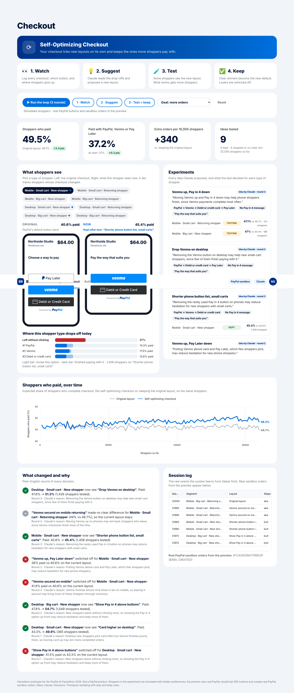
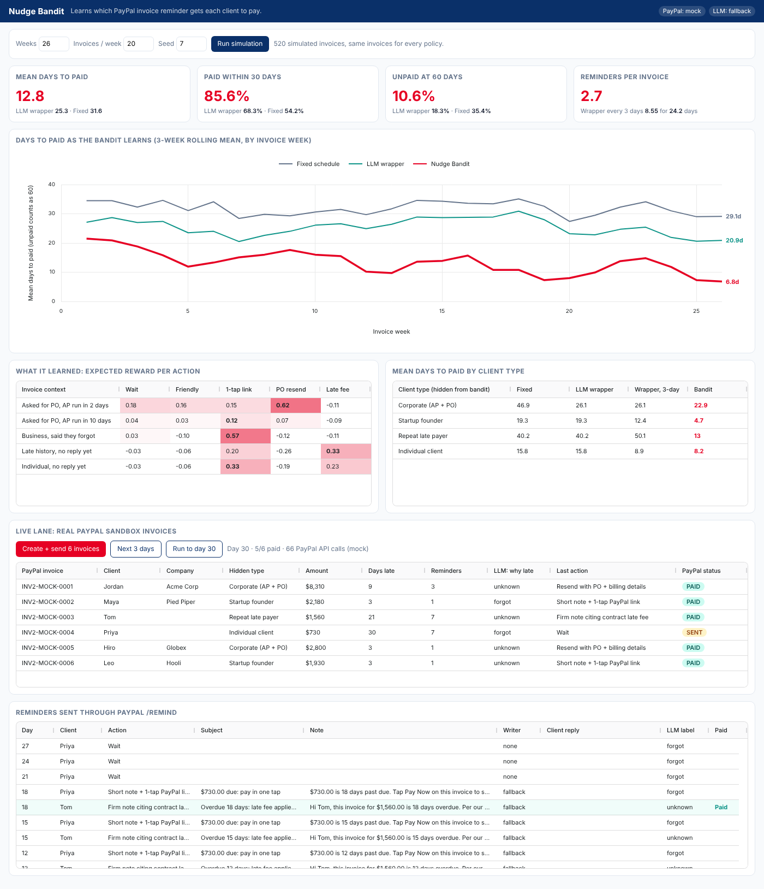

# PayPal AI Hackathon, October 2026

This repo holds two apps that share one FastAPI service:

| App | URL | What it does |
|---|---|---|
| **Self-Optimizing Checkout** | [/checkout](https://paypal-ai-invoice-reminders.onrender.com/checkout) | The checkout watches where shoppers give up, Claude suggests a better layout, a statistical test proves it, and only winners are kept. |
| **Smart Invoice Reminders** | [/](https://paypal-ai-invoice-reminders.onrender.com) | Learns which PayPal invoice reminder gets each client to pay. |

## Self-Optimizing Checkout

**In plain words:** every store shows every shopper the same checkout, but different shoppers get stuck in different places. This checkout works like a store manager who never sleeps:

1. **Watch:** log every checkout, which button each shopper tapped and where they gave up.
2. **Suggest:** Claude reads the drop-offs and proposes a new layout, with a one-line reason.
3. **Test:** some shoppers see the new layout; what works automatically gets more shoppers.
4. **Keep:** clear winners become the default for that type of shopper; bad ideas switch themselves off.



**How it is built**

* `app/checkout/sim.py`: simulated shoppers with hidden traits (PayPal account, Venmo user, age) and step-by-step funnel events.
* `app/checkout/advisor.py`: Claude reads the funnel per shopper segment and proposes up to 3 layouts as JSON. It may change only button order, the Pay in 4 message position, and the headline. Proposals are validated (PayPal and card must always be offered).
* `app/checkout/engine.py`: Thompson sampling with a Beta-Bernoulli model per segment and layout. Keep at a 95% chance of being best; stop early at a 97% chance of being worse. Goal: all orders, or checkouts paid with PayPal, Venmo or Pay Later.
* `app/static/checkout.html`: live preview with real PayPal JavaScript SDK buttons and Pay in 4 messages; paying from the preview creates and captures a real sandbox order (Orders API v2).

Result of one run (32,000 simulated shoppers, 9 ideas from Claude, 4 kept): checkout conversion 46.1% → 49.5%, about 340 more orders per 10,000 shoppers. Shoppers are simulated; buttons, messages and orders are real PayPal sandbox calls.

---

# Smart Invoice Reminders for PayPal

Smart Invoice Reminders learns which PayPal invoice reminder gets each client to pay, then proves it with a measured gain in days-to-paid.

Most invoicing tools, and most LLM add-ons, send the same polite reminder on a fixed schedule. Clients do not pay late for the same reason. A corporate accounts payable team needs a PO number before its payment run. A startup founder forgot and will pay from a phone in one tap. A repeat late payer moves only when a late fee is mentioned. This app treats each reminder as a decision, observes whether the client paid, and updates what it does next.

**Live demo:** https://paypal-ai-invoice-reminders.onrender.com (free tier; the first load after idle takes about 50 seconds)



## How it works

```
client reply ──> LLM labels why it is late ──┐
invoice facts (business?, size, history) ────┼──> contextual bandit picks: wait | friendly | 1-tap link | PO resend | late fee
calendar (AP payment run soon?) ─────────────┘                     │
                                                                   v
                                     LLM writes the reminder in that style
                                                                   │
                                                                   v
                                     PayPal /v2/invoicing/invoices/{id}/remind
                                                                   │
                                     paid before next decision? ──> reward ──> bandit update
```

* **Bandit:** disjoint linear Thompson sampling, one Bayesian linear regression per action over 10 context features (`app/bandit.py`). Reward is 1 if the invoice is paid before the next decision, minus a cost per reminder that grows after the second reminder, so it learns to back off instead of spamming.
* **LLM:** labels client replies (`needs_po`, `forgot`, `cash_tight`, `other`), which become bandit features, and writes the reminder subject and note in the style the bandit chose (`app/llm.py`).
* **PayPal:** every live invoice exists in the PayPal sandbox. The app creates and sends it, sends each reminder through `/remind` with the LLM-written note, records the payment when the client pays, and reads the status back (`app/paypal.py`).

## Results (simulation, 520 invoices, 26 weeks, seed 7)

All policies see the same invoices.

| Policy | Mean days to paid | Median | Paid within 30 days | Unpaid at 60 days | Reminders per invoice |
|---|---|---|---|---|---|
| Fixed schedule | 31.6 | 23.5 | 54.2% | 35.4% | 3.1 |
| LLM wrapper (reads replies, fixed timing) | 25.3 | 20.0 | 68.3% | 18.3% | 2.7 |
| LLM wrapper, every 3 days | 24.2 | 10.0 | 66.9% | 31.2% | 8.6 |
| **Learning bandit** | **12.8** | **4.0** | **85.6%** | **10.6%** | **2.7** |

The bandit sends the same number of reminders as the LLM wrapper and gets paid in half the time. Reminding more often does not close the gap; the every-3-days wrapper sends 3x more reminders and is still near 24 days. Results hold across seeds (`tests/test_core.py`).

**Caveat.** The clients are simulated, and their hidden behaviors are defined in `app/simulator.py`. The numbers show that the method finds per-segment strategies and that the gain does not come from spamming. They are not a forecast for a real business. The next step is to fit the simulator to a real invoice history.

## PayPal APIs used

| Call | Purpose |
|---|---|
| `POST /v1/oauth2/token` | Sandbox auth |
| `POST /v2/invoicing/invoices` | Create invoice (PO in `detail.reference`) |
| `POST /v2/invoicing/invoices/{id}/send` | Send to client |
| `POST /v2/invoicing/invoices/{id}/remind` | Send the bandit-chosen, LLM-written reminder |
| `POST /v2/invoicing/invoices/{id}/payments` | Record payment when the client pays |
| `GET /v2/invoicing/invoices/{id}` | Read status back from PayPal |

## AI tools used

| Tool | Use |
|---|---|
| Claude (Anthropic API, `claude-haiku-5-5` by default) | Labels client replies and writes reminder subject and note |
| Linear Thompson sampling (NumPy, written for this project) | Chooses the reminder action per invoice and learns from payments |
| Claude | Coding assistant during development |

OpenAI works too (`OPENAI_API_KEY`). With no key, deterministic fallbacks keep the app runnable, and the UI shows `LLM: fallback`.

## Run it

```bash
git clone https://github.com/vibedatascience/paypal-ai-hackathon-oct-2026 && cd paypal-ai-hackathon-oct-2026
pip install -r requirements.txt
cp .env.example .env    # add PayPal sandbox + Anthropic keys, or leave blank for mock mode
uvicorn app.main:app --port 8000
# open http://localhost:8000
```

1. The simulation runs on page load. Change weeks, invoices per week, or seed and click **Run simulation**.
2. Click **Create + send 6 invoices** to create real sandbox invoices.
3. Click **Next 3 days** or **Run to day 30**. Each reminder goes through PayPal `/remind`, and paid invoices flip to PAID in PayPal.

The header shows `PayPal: sandbox` or `PayPal: mock`.

### PayPal sandbox setup

1. developer.paypal.com > Apps & Credentials > Sandbox > Create App.
2. In the app's features, make sure **Invoicing** is enabled.
3. Copy the Client ID and Secret into `.env`.
4. Set `PAYPAL_RECIPIENT_EMAIL` to a sandbox personal account email (Testing Tools > Sandbox Accounts).

### Deploy on Render

`render.yaml` is included. New > Blueprint > pick this repo, then fill in the secret env vars.

## Tests

```bash
pip install pytest && python -m pytest -q
```

## License

MIT
